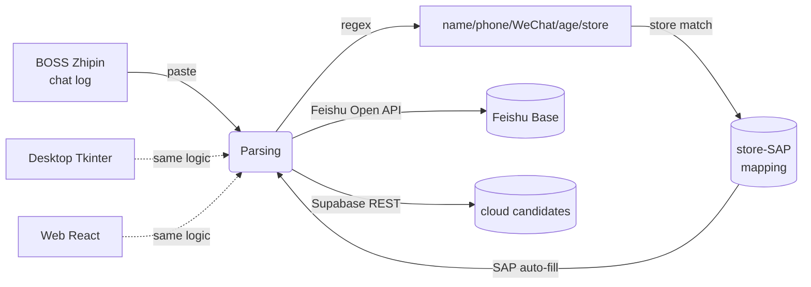

<div align="center">

# Candidate Information Entry System

**Recruitment data entry automation: from BOSS Zhipin chat logs to Feishu (Lark) Base, in one click**

[](https://portfolio-web-wine-nine.vercel.app)
[](https://react.dev)
[](https://www.python.org)
[](https://supabase.com)
[](./LICENSE)

[Live Demo](https://portfolio-web-wine-nine.vercel.app) · Demo account `admin` / `Aa@123456` · [中文](./README.md)

</div>

---

## 📌 What is this

Built during my HR internship at the instant-retail division of a chain retailer, where recruiters had to manually **copy** candidate info from BOSS Zhipin chats, **look up** store SAP codes from a 400+ entry code library, and **type** everything into Feishu Base — repetitive copy-paste work, error-prone and slow.

This tool compresses that pipeline into:

> **Paste chat log → auto-parse → SAP auto-matching → one-click write to Feishu**

The desktop version was used in production by the recruiting team; the web version later added cloud sync via Supabase.


## 🚀 Evolution

Not a one-shot portfolio piece — it went through 6 iterations driven by real business needs:

| Date | Version | Milestone |
|---|---|---|
| 2026.05 | Desktop v1.0 → v3.1 | Tkinter 3-tab app: parsing / SAP codes / image library |
| 2026.06.13 | Desktop v4.0 | Multi-account Feishu management (Tab4), Feishu Base API integration |
| 2026.06.15 | Web | React + Vite + Tailwind port of the 4-tab UI |
| 2026.06.16 | Cloud | Supabase: auth + cloud sync for SAP codes / Feishu accounts |
| 2026.06.22 | Desktop final (2,252 LOC) | Login, user management, team multi-user support |
| 2026.08 | Reliability | Daily 3:00 AM automated full backup (also keeps the free-tier project alive) |

## ✨ Features

| Module | Capability |
|---|---|
| **Tab1 Parsing** | Paste chat log → regex-extract name / phone / WeChat / age / store; store name → SAP code auto-lookup; one-click write to Feishu Base |
| **Tab2 SAP Codes** | Tree-based management of store ↔ position ↔ SAP mappings: fuzzy search, CRUD, inline edit, publish stats, column-width memory |
| **Tab3 Image Library** | Business screenshots (store manager contacts): preview / fullscreen / copy-to-clipboard / upload as Feishu attachment |
| **Tab4 Feishu Accounts** | Multi-app credential management, active-account switching, tenant access token connectivity test |
| **System** | Auth (local bcrypt / Supabase), user management, single-instance guard, layout persistence |

## 🏗️ Architecture



**Dual client, one product**: desktop (`desktop/`, Python Tkinter, production) and web (`src/`, React 18) implement the same 4-tab interaction, backed by local JSON and Supabase cloud storage.

## 🛠️ Getting Started

### Web

```bash
git clone https://github.com/wang189327-wq/candidate-information--entry.git
cd candidate-information--entry
npm install
npm run dev          # http://localhost:5173
```

Cloud features (login / SAP sync) require your own Supabase project — see [`.env.example`](./.env.example). All tab features work offline with localStorage persistence.

### Desktop

```bash
cd desktop
pip install pillow bcrypt supabase
python 求职者信息录入.py    # local mode, built-in account admin / Aa@123456
```

See [`desktop/README.md`](./desktop/README.md) to connect your own Feishu app.

## 🔒 Privacy & Security

- All secrets removed from source; injected via env vars / config files (`.env.example`)
- Real business screenshots (store manager contact info) are **not** distributed in this repo
- `sap_config.json` / `feishu_accounts.json` contain sample data only

## 📄 License

[MIT](./LICENSE) © Wang Mei
