<div align="center">

# Candidate Information Entry System

**Recruitment data entry automation: from job-board chat logs to any target system, in one click**

[](https://wang189327-wq.github.io/candidate-entry/)
[](https://portfolio-web-wine-nine.vercel.app)
[](https://react.dev)
[](https://www.python.org)
[](https://supabase.com)
[](./LICENSE)
[](https://github.com/wang189327-wq/candidate-entry/actions/workflows/ci.yml)

[Live Demo](https://wang189327-wq.github.io/candidate-entry/) · Demo account `admin` / `Aa@123456` · [中文](./README.md)

</div>

---

## 📌 What is this

Built during my HR internship on front-line store recruitment, where recruiters had to manually **copy** candidate info from job-board chats, **look up** store SAP codes from a 400+ entry code library, and **type** everything into a target system (Feishu Base / Supabase / custom webhook / local export) — repetitive copy-paste work, error-prone and slow.

This tool compresses that pipeline into:

> **Paste chat log → auto-parse → SAP auto-matching → one-click write** (pluggable targets: Supabase / Feishu / Webhook / local export)

The desktop version was used in production by the recruiting team; the web version later added cloud sync via Supabase.

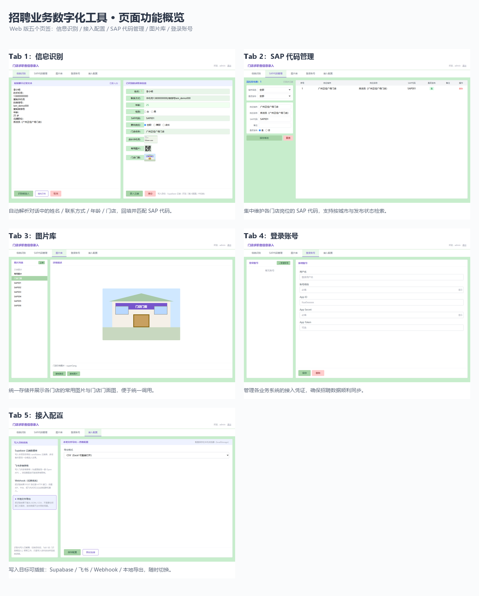

## 🎬 Demo

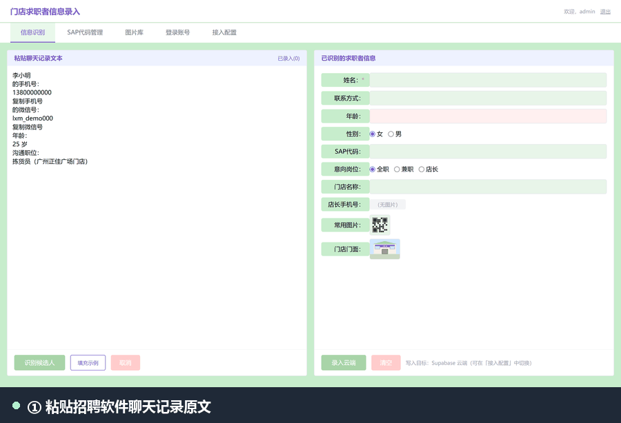

<sub>Paste → parse → switch write target → write, in 9 steps. Switching the target in *Integrations* keeps whatever you already filled in on Tab 1.</sub>

## 🚀 Evolution

Not a one-shot portfolio piece — it went through 6 iterations driven by real business needs:

| Date | Version | Milestone |
|---|---|---|
| 2026.03 | Desktop v1.0 → v3.1 | Tkinter 3-tab app: parsing / SAP codes / image library |
| 2026.04.13 | Desktop v4.0 | Multi-account Feishu management (Tab4), Feishu Base API integration |
| 2026.04.15 | Web | React + Vite + Tailwind port of the 4-tab UI |
| 2026.05.16 | Cloud | Supabase: auth + cloud sync for SAP codes / Feishu accounts |
| 2026.05.22 | Desktop final (2,252 LOC) | Login, user management, team multi-user support |
| 2026.08 | Reliability | Daily 3:00 AM automated full backup (also keeps the free-tier project alive) |

## ✨ Features

| Module | Capability |
|---|---|
| **Tab1 Parsing** | Paste chat log → regex-extract name / phone / WeChat / age / store; store name → SAP code auto-lookup; write to the configured target |
| **Tab2 SAP Codes** | Table-based management of store ↔ position ↔ SAP mappings: filter by city / publish status, CRUD, double-click a row to edit, publish stats |
| **Tab3 Image Library** | Unified store-asset storage: preview / fullscreen view / copy image path & link, upload to cloud storage, group by SAP code |
| **Tab4 Accounts** | System account management: create/edit users and reset passwords (admins see all, regular users only their own); also holds Feishu app credentials (App ID / App Secret / App Token) used by the Feishu write target |
| **Tab5 Integrations** | **Pluggable write target**: Feishu Base / any Webhook (DingTalk, WeCom, custom API) / Supabase / local CSV export — switch + test connectivity in one click |
| **System** | Auth (bcrypt), user management, tab state preserved across switches |

### 📸 Screens

Two variants per tab — **empty state** (initial screen) and **working state** (after parsing / selection).

| Empty · Tab1 Parsing | Empty · Tab2 SAP Codes |
|---|---|
| 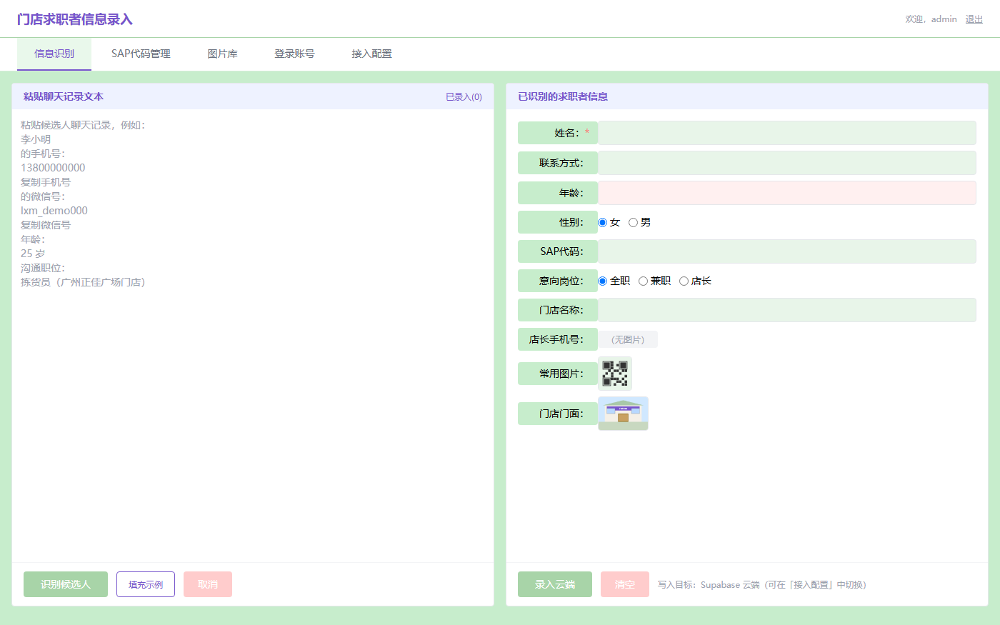 | 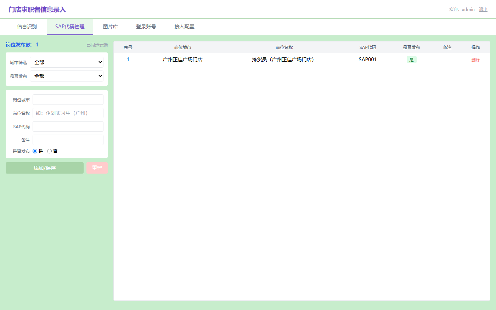 |

| Empty · Tab3 Image Library | Empty · Tab4 Accounts | Empty · Tab5 Integrations |
|---|---|---|
| 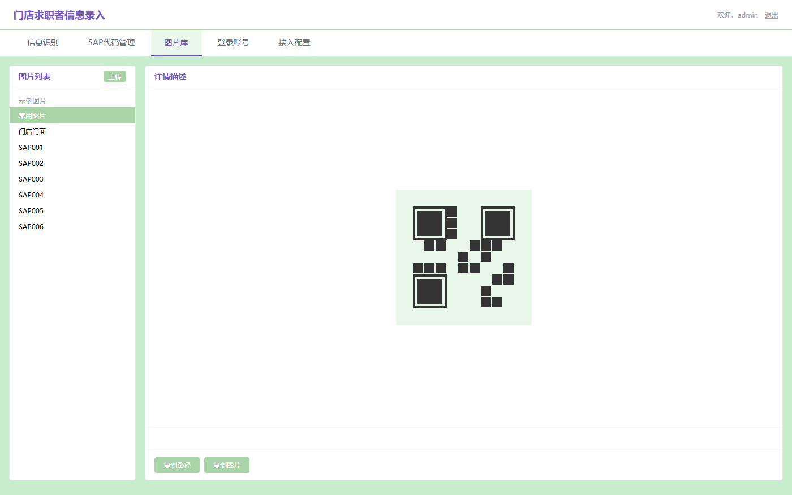 | 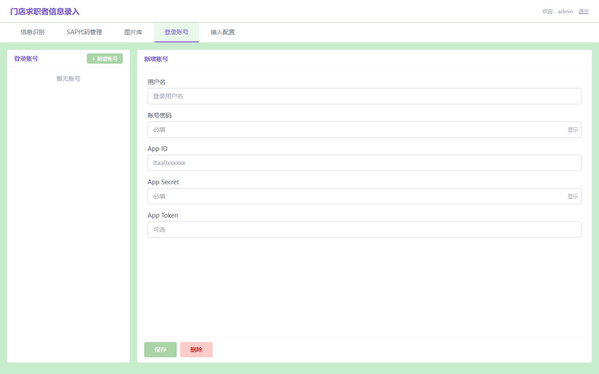 | 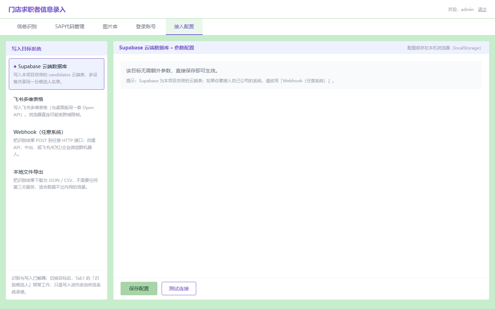 |

| Working · Tab1 Parsing | Working · Tab2 SAP Codes |
|---|---|
| 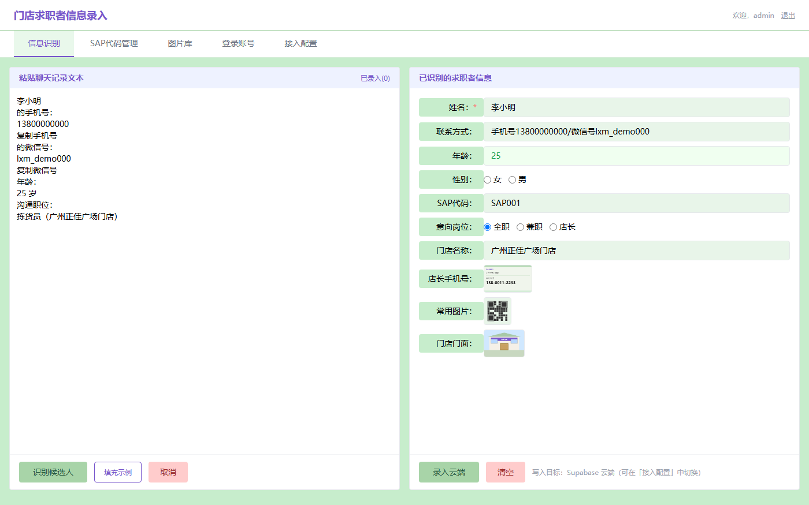 | 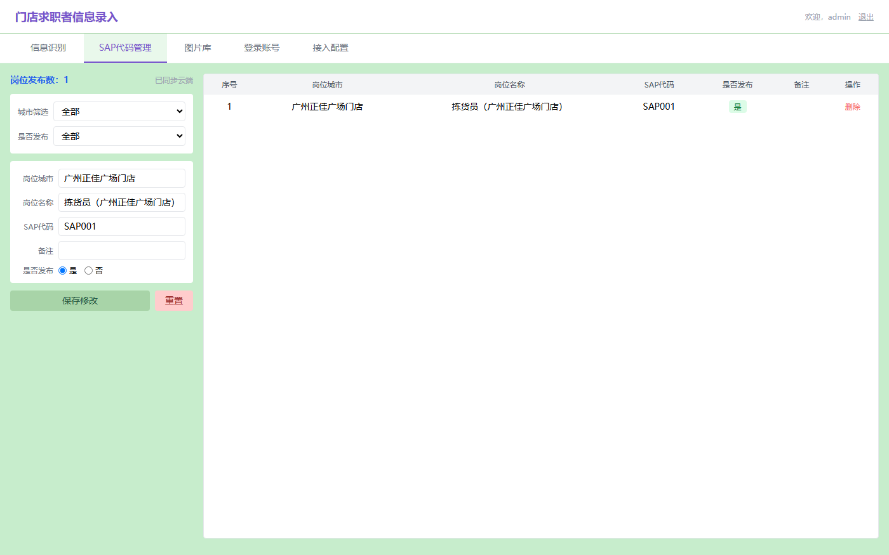 |

| Working · Tab3 Image Library | Working · Tab4 Accounts | Working · Tab5 Integrations |
|---|---|---|
| 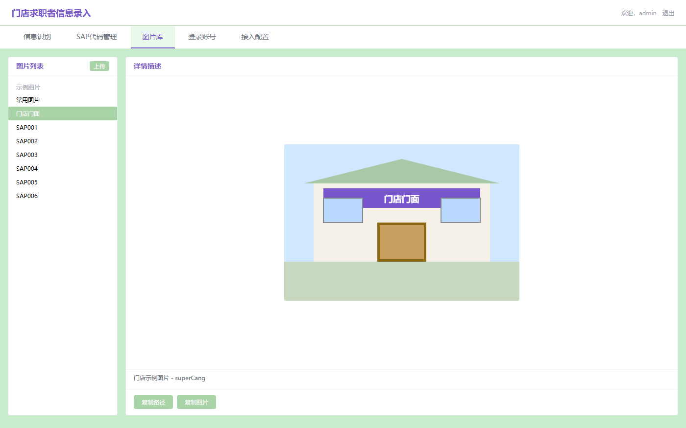 | 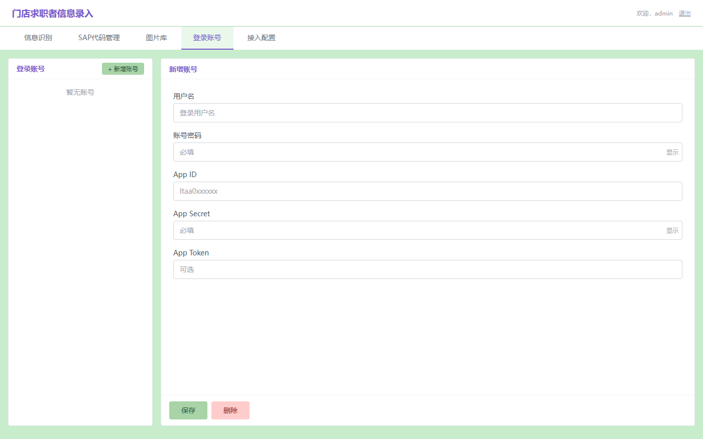 | 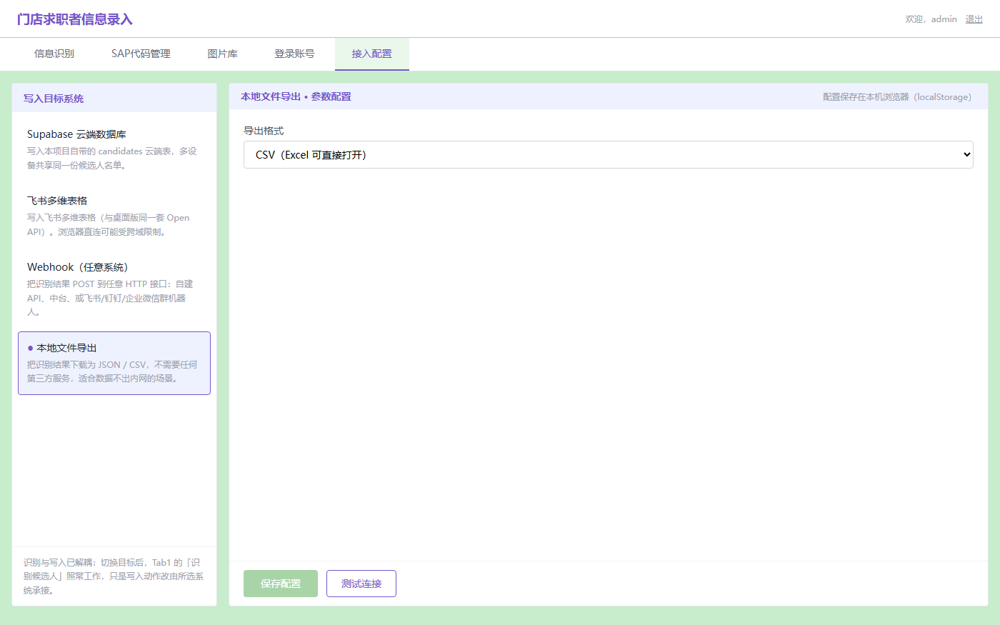 |

### 🔌 Pluggable write target (Feishu is optional)

Parsing and writing are fully decoupled: the parser only produces a standard record (name / age / gender / contact / SAP code / position / store) — **where it lands is your choice** in the *Integrations* tab:

| Target | Notes |
|---|---|
| **Webhook · generic JSON** | POST to any HTTP endpoint — your own API, a middleware, a DB gateway |
| **Webhook · group bots** | Same endpoint, different payload → Feishu / DingTalk / WeCom group robots |
| **Feishu Base** | Same Open API as the desktop build (if the browser hits CORS limits, use the Webhook path) |
| **Supabase** | The bundled `candidates` table, shared across devices |
| **Local CSV / JSON** | No service required — the browser downloads a file that Excel opens directly |

> Adding a new target means implementing `{ id, name, fields, write(), test() }` and registering it in `src/lib/adapters/index.js` — roughly 40 lines.

## 🏗️ Architecture

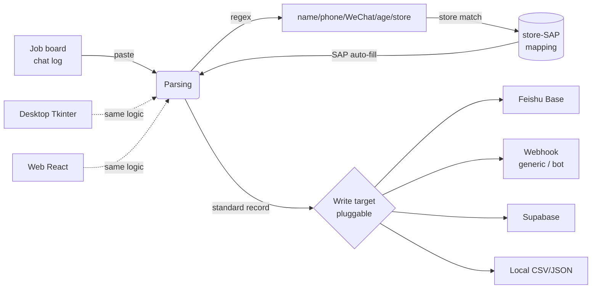

**Dual client, one product**: desktop (`desktop/`, Python Tkinter, production) and web (`src/`, React 18) implement the same multi-tab interaction, backed by local JSON and Supabase cloud storage; every write goes through the adapter router, so the target system is swappable.

| Client | Stack | Notes |
|---|---|---|
| Web | React 18 · Vite · Tailwind CSS · Supabase JS · bcryptjs | [Try it live](https://wang189327-wq.github.io/candidate-entry/) |
| Desktop | Python Tkinter · Feishu Open API · Pillow · bcrypt | 2,469 LOC, shipped to the recruiting team |

### 🌐 Live Deployments

Two public entry points, both auto-deployed from the `main` branch and kept in sync:

| Entry | URL | Pipeline |
|---|---|---|
| Primary | [wang189327-wq.github.io/candidate-entry](https://wang189327-wq.github.io/candidate-entry/) | GitHub Actions → GitHub Pages |
| Alternate | [portfolio-web-wine-nine.vercel.app](https://portfolio-web-wine-nine.vercel.app) | Vercel GitHub integration (production branch `main`) |

Every push to `main` triggers both pipelines: GitHub Actions runs the build check and secret scan, then publishes Pages; Vercel produces the production deployment in parallel.

### 🧪 Quality Gates

| Stage | Tool | Coverage |
|---|---|---|
| Unit tests | Vitest | 80 tests: parser 40 · adapter contract 17 · HTTP wrapper 12 · CSV escaping 11 |
| Lint | ESLint | react / react-hooks plugins, currently **zero warnings** |
| Formatting | Prettier | all JS/JSX/JSON, `format:check` runs in CI |
| Secret scan | custom script | scans all 73 tracked files, blocks on any hit |
| Dependency audit | npm audit | production deps only, high-severity issues block CI |
| Workflow validation | custom script | checks Actions schema locally, so a malformed workflow fails fast |
| Desktop syntax | Python AST | full parse of the 2469-line single file |

```bash
npm run verify    # lint + format:check + test + build in one go
```

CI (`.github/workflows/ci.yml`) runs every check above on push and pull requests; any failure blocks the merge.

## 🛠️ Getting Started

### Web

```bash
git clone https://github.com/wang189327-wq/candidate-entry.git
cd candidate-entry
npm install
npm run dev          # http://localhost:5173
npm run verify       # lint + format:check + test + build
```

Cloud features (login / SAP sync / cloud writes) connect to the bundled public demo project by default. To use your own Supabase, copy [`.env.example`](./.env.example) to `.env.local` and fill in `VITE_SUPABASE_URL` / `VITE_SUPABASE_ANON_KEY` (the browser only ever gets the anon key — configure RLS accordingly). The desktop build reads `SUPABASE_URL` / `SUPABASE_SERVICE_KEY` as real environment variables; `.env.local` has no effect on Python.

### Desktop

```bash
cd desktop
pip install pillow bcrypt supabase
python 求职者信息录入.py    # local mode, built-in account admin / Aa@123456
```

See [`desktop/README.md`](./desktop/README.md) to connect your own Feishu app.

## 🔒 Privacy & Security

- **Sensitive secrets** (service_role keys, Feishu App Secrets, DB passwords) are never committed — they are injected via env vars / config files (`.env.example`). Source only keeps the Supabase **anon key**, which is public by design and protected by RLS; it can be overridden with `VITE_SUPABASE_*`.
- Real business screenshots (store manager contact info) are **not** distributed in this repo
- `sap_config.json` / `feishu_accounts.json` contain sample data only
- The public demo Supabase project ships sample data as well (1 SAP code); the full 400+ entry library lives in the production environment
- The live demo does its role check in the browser for easy trial — **never enter real candidate data or real credentials there**; see [SECURITY.md](./SECURITY.md) for the hardening checklist before production use

## 📄 License

[MIT](./LICENSE) © Wang Mei
