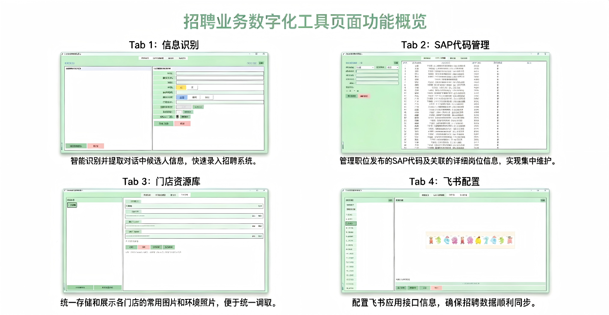
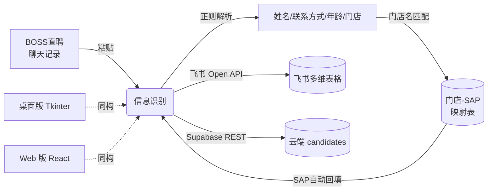

<div align="center">

# 门店求职者信息录入系统

**招聘信息录入自动化：从 BOSS 直聘聊天记录到飞书多维表格，一键完成**

[](https://portfolio-web-wine-nine.vercel.app)
[](https://react.dev)
[](https://www.python.org)
[](https://supabase.com)
[](./LICENSE)

[在线演示](https://portfolio-web-wine-nine.vercel.app) · 演示账号 `admin` / `Aa@123456` · [English](./README.en.md)

</div>

---

## 📌 这是什么项目

连锁零售企业即时零售业务店招聘场景下，招聘专员每天要做的机械劳动：

> 从 BOSS 直聘聊天记录里**复制**求职者姓名、电话、微信、意向门店 → 到 400+ 条 SAP 岗位代码库里**粘贴查找**门店对应代码 → 再**逐字段录入**飞书多维表格

一条记录多次复制粘贴，容易录错、效率低。本项目把这条链路压缩成：

> **粘贴聊天记录 → 自动解析 → SAP 自动匹配 → 一键写入飞书**

项目源于实习期间的真实业务需求，桌面版已在团队日常招聘工作中持续投产使用，后升级为支持云端同步的 Web 版。



## 🚀 项目演进

这不是一次性写完的作品，而是在真实业务中迭代了 6 个版本的劳动工具：

| 时间 | 版本 | 关键变化 |
|---|---|---|
| 2026.05 | 桌面版 v1.0 → v3.1 | Tkinter 三页签：信息识别 / SAP 代码 / 图片库，布局持久化 |
| 2026.06.13 | 桌面版 v4.0 | 新增飞书多账号管理（Tab4），直连飞书多维表格 API |
| 2026.06.15 | Web 版 | React + Vite + Tailwind 复刻四页签，纯前端可交互原型 |
| 2026.06.16 | 云端化 | 接入 Supabase：登录认证 + SAP 代码 / 飞书账号云端同步 |
| 2026.06.22 | 桌面终版（2252 行） | 登录窗口、用户管理、账号绑定，团队多人使用 |
| 2026.08 | 数据保障 | Supabase 每日 3:00 自动全量备份（顺带解决了免费层休眠问题） |

## ✨ 核心功能

| 模块 | 能力 |
|---|---|
| **Tab1 信息识别** | 粘贴聊天记录，正则解析姓名 / 手机号 / 微信号 / 年龄 / 门店；门店名 → SAP 代码自动查表回填；一键写入飞书多维表格 |
| **Tab2 SAP 代码管理** | 门店 ↔ 岗位 ↔ SAP 映射的树形管理：模糊搜索、增删改、双击编辑、发布状态统计、列宽记忆 |
| **Tab3 图片库** | 店长联系方式截图等业务图片：预览 / 全屏 / 复制到剪贴板（直接粘进微信）/ 上传飞书附件 |
| **Tab4 飞书账号管理** | 多飞书应用凭证管理、活跃账号切换、Tenant Access Token 连通性测试 |
| **系统层** | 登录认证（本地 bcrypt / Supabase 云端）、用户管理与密码重置、多实例保护、界面布局持久化 |

## 🏗️ 架构与数据流



**双端同构**：桌面版（`desktop/`，Python Tkinter，生产使用）与 Web 版（`src/`，React 18）实现同一套四页签交互；数据层本地 JSON 与 Supabase 云端双轨。

| 端 | 技术栈 | 说明 |
|---|---|---|
| Web 版 | React 18 · Vite · Tailwind CSS · Supabase JS · bcryptjs | 在线可玩，[点此体验](https://portfolio-web-wine-nine.vercel.app) |
| 桌面版 | Python Tkinter · 飞书 Open API · Pillow · bcrypt | 2252 行，实习期间团队投产版本 |

## 🛠️ 快速开始

### Web 版

```bash
git clone https://github.com/wang189327-wq/candidate-information--entry.git
cd candidate-information--entry
npm install
npm run dev          # http://localhost:5173
```

云端功能（登录 / SAP 云同步）需自建 Supabase 项目，参考 [`.env.example`](./.env.example)。纯前端原型模式下 Tab 功能全部可用（localStorage 持久化）。

### 桌面版

```bash
cd desktop
pip install pillow bcrypt supabase
python 求职者信息录入.py    # 本地模式内置账号 admin / Aa@123456
```

接入你自己的飞书应用与多维表格：见 [`desktop/README.md`](./desktop/README.md)。

## 📂 目录结构

```
├── src/                    # Web 版（React 18 + Vite + Tailwind）
│   ├── components/         #   Tab1~Tab4 四大功能组件
│   ├── data/               #   初始 SAP 配置与示例数据
│   ├── lib/                #   Supabase 客户端
│   └── utils/              #   聊天记录解析、示例图片生成
├── desktop/                # 桌面版（Python Tkinter，生产版本）
│   ├── 求职者信息录入.py     #   2252 行单文件应用
│   ├── 数据/                #   配置与示例数据（已脱敏）
│   └── README.md           #   运行说明与数据文件规范
├── docs/images/            # 文档图片
├── SPEC.md                 # Web 版设计规格
└── .env.example            # 环境变量模板
```

## 🔒 隐私与安全

- 所有密钥已从代码中移除，改用环境变量 / 配置文件注入（见 `.env.example`）
- 门店联系方式截图等真实业务素材**不随仓库分发**
- `sap_config.json`、`feishu_accounts.json` 均为示例数据，生产数据在团队内网环境

## 📄 License

[MIT](./LICENSE) © Wang Mei
