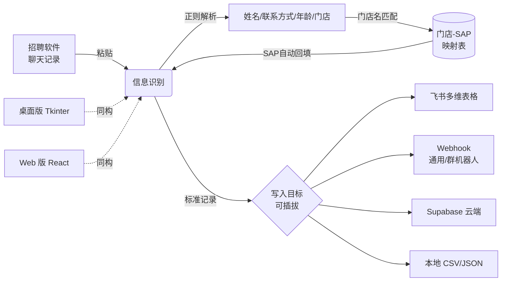

<div align="center">

# 门店求职者信息录入系统

**招聘信息录入自动化：从招聘软件聊天记录到任意业务系统，一键完成**

[](https://wang189327-wq.github.io/candidate-entry/)
[](https://portfolio-web-wine-nine.vercel.app)
[](https://react.dev)
[](https://www.python.org)
[](https://supabase.com)
[](./LICENSE)
[](https://github.com/wang189327-wq/candidate-entry/actions/workflows/ci.yml)

[在线演示](https://wang189327-wq.github.io/candidate-entry/) · 演示账号 `admin` / `Aa@123456` · [English](./README.en.md)

</div>

---

## 📌 这是什么项目

一线门店招聘场景中，招聘专员每天要做的机械劳动：

> 从招聘软件聊天记录里**复制**求职者姓名、电话、微信、意向门店 → 到 400+ 条 SAP 岗位代码库里**粘贴查找**门店对应代码 → 再**逐字段录入**目标系统（飞书多维表格 / Supabase / 自建 Webhook / 本地导出）

一条记录多次复制粘贴，容易录错、效率低。本项目把这条链路压缩成：

> **粘贴聊天记录 → 自动解析 → SAP 自动匹配 → 一键写入**（写入目标可插拔：Supabase / 飞书 / Webhook / 本地导出）

项目源于实习期间的真实业务需求，桌面版已在团队日常招聘工作中持续投产使用，后升级为支持云端同步的 Web 版。


## 🎬 演示动线


<sub>从粘贴聊天记录到一键写入，全流程 9 步；写入目标可在「接入配置」中随时切换，切换后 Tab1 已填数据不丢失。</sub>

## 🚀 项目演进

这不是一次性写完的作品，而是在真实业务中迭代了 6 个版本的劳动工具：

| 时间 | 版本 | 关键变化 |
|---|---|---|
| 2026.03 | 桌面版 v1.0 → v3.1 | Tkinter 三页签：信息识别 / SAP 代码 / 图片库，布局持久化 |
| 2026.04.13 | 桌面版 v4.0 | 新增飞书多账号管理（Tab4），直连飞书多维表格 API |
| 2026.04.15 | Web 版 | React + Vite + Tailwind 复刻四页签，纯前端可交互原型 |
| 2026.05.16 | 云端化 | 接入 Supabase：登录认证 + SAP 代码 / 飞书账号云端同步 |
| 2026.05.22 | 桌面终版（2252 行） | 登录窗口、用户管理、账号绑定，团队多人使用 |
| 2026.08 | 数据保障 | Supabase 每日 3:00 自动全量备份（顺带解决了免费层休眠问题） |

## ✨ 核心功能

| 模块 | 能力 |
|---|---|
| **Tab1 信息识别** | 粘贴聊天记录，正则解析姓名 / 手机号 / 微信号 / 年龄 / 门店；门店名 → SAP 代码自动查表回填；一键写入目标系统 |
| **Tab2 SAP 代码管理** | 门店 ↔ 岗位 ↔ SAP 映射的表格化管理：按城市 / 发布状态筛选、增删改、双击行进入编辑、发布数量统计 |
| **Tab3 图片库** | 门店素材统一存储：图片预览 / 全屏查看 / 复制图片路径与链接、上传到云端存储、按 SAP 代码归类 |
| **Tab4 登录账号** | 系统账号管理：新增/编辑用户与密码重置（管理员可见全部账号，普通用户仅见自己）；同时可维护飞书应用凭证（App ID / App Secret / App Token）供飞书写入目标使用 |
| **Tab5 接入配置** | **写入目标可插拔**：飞书多维表格 / 任意 Webhook（钉钉、企业微信、自建 API）/ Supabase 云端 / 本地 CSV 导出，一键切换 + 连通性测试 |
| **系统层** | 登录认证（bcrypt 校验）、用户管理与密码重置、页签切换状态保留 |

### 📸 界面一览

**空态**（初始界面）与**工作态**（已识别 / 已选中）各一版，便于对照了解交互前后的状态变化。

| 空态 · Tab1 信息识别 | 空态 · Tab2 SAP 代码管理 |
|---|---|
|  |  |

| 空态 · Tab3 图片库 | 空态 · Tab4 登录账号 | 空态 · Tab5 接入配置 |
|---|---|---|
|  |  |  |

| 工作态 · Tab1 信息识别 | 工作态 · Tab2 SAP 代码管理 |
|---|---|
|  |  |

| 工作态 · Tab3 图片库 | 工作态 · Tab4 登录账号 | 工作态 · Tab5 接入配置 |
|---|---|---|
|  |  |  |

### 🔌 写入目标可插拔（不必用飞书）

「识别」与「写入」彻底解耦：解析逻辑只产出标准记录（姓名 / 年龄 / 性别 / 联系方式 / SAP代码 / 意向岗位 / 门店名称），**写到哪里由你在「接入配置」中选**：

| 目标 | 说明 |
|---|---|
| **Webhook · 通用 JSON** | POST 到任意 HTTP 接口：自建 API、中台、数据库网关，直接对接你公司现有系统 |
| **Webhook · 群机器人** | 同一套接口换报文即可发到飞书 / 钉钉 / 企业微信群 |
| **飞书多维表格** | 与桌面版同一套 Open API（浏览器直连若受跨域限制，可改用上面的 Webhook 方案） |
| **Supabase 云端** | 本项目自带的 candidates 表，多设备共享 |
| **本地 CSV / JSON** | 不依赖任何服务，浏览器直接下载文件，Excel 可打开 |

> 新增一个目标系统只需实现 `{ id, name, fields, write(), test() }` 并注册到 `src/lib/adapters/index.js`，约 40 行代码。

## 🏗️ 架构与数据流



**双端同构**：桌面版（`desktop/`，Python Tkinter，生产使用）与 Web 版（`src/`，React 18）实现同一套多页签交互；数据层本地 JSON 与 Supabase 云端双轨；写入层统一走适配器路由，目标系统可换。

| 端 | 技术栈 | 说明 |
|---|---|---|
| Web 版 | React 18 · Vite · Tailwind CSS · Supabase JS · bcryptjs | 在线可玩，[点此体验](https://wang189327-wq.github.io/candidate-entry/) |
| 桌面版 | Python Tkinter · 飞书 Open API · Pillow · bcrypt | 2469 行，实习期间团队投产版本 |

### 🌐 在线部署

两个公开入口，均由本仓库 `main` 分支自动部署、内容实时同步：

| 入口 | 地址 | 部署方式 |
|---|---|---|
| 主线（推荐） | [wang189327-wq.github.io/candidate-entry](https://wang189327-wq.github.io/candidate-entry/) | GitHub Actions → GitHub Pages |
| 备选 | [portfolio-web-wine-nine.vercel.app](https://portfolio-web-wine-nine.vercel.app) | Vercel GitHub 集成（生产分支 `main`） |

每次 `push` 到 `main` 会同时触发两条链路：GitHub Actions 做构建校验与密钥扫描，通过后发布 Pages；Vercel 侧同步生成生产部署。

### 🧪 质量保障

| 环节 | 工具 | 覆盖范围 |
|---|---|---|
| 单元测试 | Vitest | 80 项：解析层 40 · 适配器契约 17 · HTTP 封装 12 · CSV 转义 11 |
| 代码规范 | ESLint | react / react-hooks / jsx-a11y 插件，当前**零错误零警告** |
| 格式统一 | Prettier | 全量 JS/JSX/JSON，`format:check` 纳入 CI |
| 密钥扫描 | 自写脚本 | 73 个文件全量扫描，命中即阻断 |
| 依赖审计 | npm audit | 仅审计生产依赖，高危漏洞阻断 CI |
| 桌面版语法 | Python AST | 单文件 2469 行全量解析 |

```bash
npm run verify    # 一键跑完 lint + format:check + test + build
```

CI（`.github/workflows/ci.yml`）在 push 与 PR 时依次执行上述全部检查，任一失败即阻断合并。

## 🛠️ 快速开始

### Web 版

```bash
git clone https://github.com/wang189327-wq/candidate-entry.git
cd candidate-entry
npm install
npm run dev          # http://localhost:5173
npm run verify       # lint + format:check + test + build
```

云端功能（登录 / SAP 云同步 / 云端写入）默认连向内置的公开演示项目。想接自己的 Supabase，复制 [`.env.example`](./.env.example) 为 `.env.local` 并填入 `VITE_SUPABASE_URL` / `VITE_SUPABASE_ANON_KEY`（前端只支持 anon key，务必配好 RLS）。桌面版的 `SUPABASE_URL` / `SUPABASE_SERVICE_KEY` 需以真实环境变量注入，`.env.local` 对 Python 无效。

### 桌面版

```bash
cd desktop
pip install pillow bcrypt supabase
python 求职者信息录入.py    # 本地模式内置账号 admin / Aa@123456
```

接入你自己的飞书应用与多维表格：见 [`desktop/README.md`](./desktop/README.md)。

## 📂 目录结构

```
├── src/                    # Web 版（React 18 + Vite + Tailwind）
│   ├── components/         #   Tab1~Tab5 五大功能组件
│   ├── data/               #   初始 SAP 配置与示例数据
│   ├── lib/
│   │   ├── adapters/       #   写入目标适配器（飞书/Webhook/Supabase/本地）
│   │   └── supabase.js     #   Supabase 客户端
│   └── utils/              #   聊天记录解析、示例图片生成
├── desktop/                # 桌面版（Python Tkinter，生产版本）
│   ├── 求职者信息录入.py     #   2469 行单文件应用
│   ├── 数据/                #   配置与示例数据（已脱敏）
│   └── README.md           #   运行说明与数据文件规范
├── docs/images/            # 文档图片
├── .github/workflows/      # CI：构建校验 + 密钥扫描
├── CHANGELOG.md            # 更新日志
├── SPEC.md                 # 技术规格（架构 / 适配器契约 / 工程化）
└── .env.example            # 环境变量模板
```

## 🔒 隐私与安全

- **敏感密钥**（service_role、飞书 App Secret、数据库密码）均不进入仓库，改用环境变量 / 配置文件注入（见 `.env.example`）；源码中仅保留 Supabase **anon key**（设计上可公开，仅受 RLS 保护），且已支持用 `VITE_SUPABASE_*` 覆盖
- 门店联系方式截图等真实业务素材**不随仓库分发**
- `sap_config.json`、`feishu_accounts.json` 均为示例数据，生产数据在团队内网环境
- 线上演示用的 Supabase 库同样只保留示例数据（SAP 代码 1 条），完整的 400+ 条门店岗位代码库在生产环境
- 在线演示站的权限判定在前端完成，便于体验；**请勿在演示站输入真实候选人信息或真实业务凭证**，生产部署前的加固清单见 [SECURITY.md](./SECURITY.md)

## 📄 License

[MIT](./LICENSE) © Wang Mei

